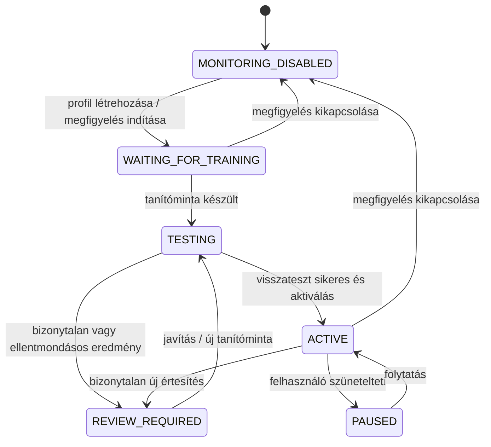
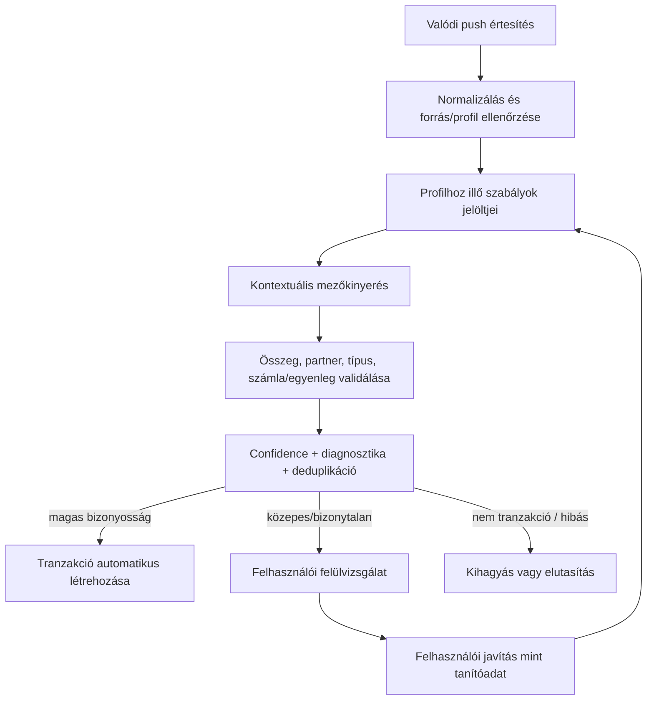
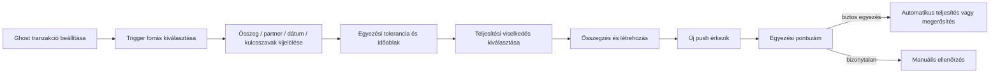

# Fluvi Push Parser v2 — workflow és koncepció

> **Dokumentációs/specifikációs commit.** Ez a változtatás a parser újratervezésének tervét rögzíti; nem állítja, hogy a parser motor implementációja elkészült vagy aktiválva lett.

## Cél

A Fluvi push importja ne gyenge, általános regexekkel keressen összeget és kereskedőnevet egymástól függetlenül. A parser a teljes értesítés kontextusából, a mezők kapcsolatából, a forrásalkalmazásból és a tranzakció típusából következtessen. A bizonytalan értelmezés ne hozzon létre automatikusan tranzakciót.

## Termék- és tanítási workflow

1. **Push import főképernyő:** értesítési hozzáférés állapota, profilok és státuszaik, elkapott értesítések, feldolgozásra váró tételek.
2. **Profil létrehozása:** a felhasználó kiválasztja a banki/pénzügyi appot és a tranzakciótípust (automatikus / kiadás / bevétel). A profil a szabály betanítása előtt is létrejön.
3. **Megfigyelés:** a Fluvi eltárolja a kiválasztott forrásból érkező értesítéseket. Ekkor még nem hoz létre tranzakciót.
4. **Értesítés kiválasztása:** a felhasználó egy valódi, releváns értesítést választ ki; a nem tranzakciós üzenetek megjelölhetők kihagyandónak.
5. **Mezők tanítása:** a felhasználó a szövegben kijelöli az összeget, partnert/kereskedőt, esetleges dátumot, számlát és egyenleget. A nem releváns rész külön jelölhető.
6. **Szabály előnézete:** a motor kontextuális mintát állít elő, például `{AMOUNT} Ft összeget fizettél itt: {MERCHANT}. A(z) {ACCOUNT} egyenlege: {BALANCE} Ft`. Az egyenleg nem válhat tévesen tranzakcióösszeggé.
7. **Visszatesztelés:** az új szabályt az összes korábban elkapott, releváns értesítésen teszteljük; az eltéréseket és a félreérthető mezőket megmutatjuk.
8. **Aktiválás:** csak kellően megbízható, teszteken átment szabály válhat automatikusan feldolgozhatóvá. Egy profil több szabályt tarthat fenn (pl. kártyás vásárlás, bejövő utalás, kimenő utalás, készpénzfelvétel).
9. **Felülvizsgálat:** alacsony vagy közepes bizonyosság esetén a felhasználó kiválasztja a helyes értelmezést, megjelöli a nem tranzakciót, vagy kihagyja az értesítést. A javítás új tanítóadatként felhasználható.

## Állapotgép



## Adatfolyam és döntési kapuk



## Parser-alapelvek és védőkorlátok

- **Kontextus, nem mezőnkénti vak keresés:** az összeghez tartozó mondatrész, kulcsszavak, partner, tranzakciótípus és forrás együtt számít.
- **Egyenlegvédelem:** a „tranzakció összege” és az „új egyenleg” külön szerep. A parser nem választhatja ki automatikusan a legnagyobb vagy első számot.
- **Fail-safe döntés:** bizonytalan eredményből nincs automatikus tranzakció.
- **Több szabály/profil:** a kártyás vásárlás, átutalás, készpénzfelvétel és nem tranzakciós értesítés eltérő mintákat igényelhet.
- **Visszatesztelés és regresszió:** minden szabályváltoztatásnál korábbi mintákon tesztelni kell; a korábban helyes mező-hozzárendelés nem romolhat.
- **Idempotencia:** ugyanaz a push ne hozzon létre duplikált tranzakciót; legyen deduplikációs ablak és stabil értesítésazonosító/hash.
- **Megmagyarázhatóság:** a felülvizsgálati képernyő mutassa a kiválasztott mezőket, a döntés okát, a confidence értéket és a hibakódot.
- **Profil létrehozása nem függ a tanítástól:** a profil megfigyelésre kész állapotban elmenthető akkor is, ha még nincs használható szabály.

## Confidence / döntési modell

A specifikációban szereplő alapértékek kiinduló konfigurációk, amelyeket tesztadatokkal kell kalibrálni:

| Döntés | Alapértelmezett tartomány |
|---|---:|
| Elutasítás / ignorálás | < 0,50 |
| Felülvizsgálat | 0,50–0,89 |
| Automatikus elfogadás | ≥ 0,90 |

A határok önmagukban nem elegendők: a kritikus mezők (összeg, típus, forrás) érvényessége és az ellentmondások külön döntési kapuk. Egy magas összpontszám sem írhatja felül az egyenleg/tranzakcióösszeg konfliktust.

## Javasolt modulhatárok

- `FluviPushParser.kt` — jelöltek előállítása és döntési folyamat.
- `PushParserModels.kt` — profil-, szabály-, tanítási-, eredmény- és diagnosztikai modellek.
- `PushNormalizer.kt` — szóközök, pénznemek, lokalizált számok, ékezetek és szöveg normalizálása.
- `PushRuleCompiler.kt` — a tanítópéldákból verziózott kontextuális szabályok előállítása.
- `PushProfileRepository.kt` — profilok és állapotok tárolása.
- `PushNotificationRepository.kt` — értesítések és feldolgozási státuszok tárolása.
- `PushTrainingService.kt` — mezőkijelölés, szabálygenerálás és visszatesztelés.
- `PushReviewService.kt` — bizonytalan esetek és felhasználói javítások kezelése.
- `PushParserTests.kt` — unit-, golden-, regressziós, deduplikációs és negatív tesztek.

## Kötelező tesztcsaládok

1. Több összeg egy értesítésben (tranzakcióösszeg + új egyenleg).
2. Kiadás/bevétel és kimenő/bejövő utalás megkülönböztetése.
3. Eltérő pénznem- és számformátumok (pl. `1 085 Ft`, `71 795,87 Ft`).
4. Partnernév több sorban, írásjelekkel vagy változó banki szöveggel.
5. Nem tranzakciós pushok (sikeres belépés, kártyaaktiválás, marketing).
6. Hiányos, duplikált, sorrendben eltérő vagy ismeretlen értesítések.
7. Több szabály közötti ütközés és egyetlen találatot megkövetelő szabály.
8. Confidence küszöbök és minden döntési útvonal.
9. Visszatesztelési regresszió: a meglévő pozitív példák továbbra is helyesen parse-olódnak.
10. Profil kikapcsolása/szüneteltetése és appcsomag-eltérés.

## Kapcsolódó UX-koncepciók

A két kapcsolódó képernyőterv a Library-ben készült: **„App onboarding a push import funkcióhoz.png”** és **„Visszatérő tranzakciós beállítások.png”**. Az első a push profil létrehozásától a mezők kijelölésén és tesztelésén át a felülvizsgálatig tartó 8 képernyős folyamatot mutatja. A második a push-alapú visszatérő tranzakció wizardját és az értesítéshez illesztett „ghost transaction” logikát mutatja. Ebben a commitban a folyamatok szöveges/diagram formában vannak rögzítve; az eredeti PNG-fájlok bináris tartalma nem került a repository-ba.

### Push-alapú visszatérő tranzakció



A push-trigger nem egy második, egymástól független parser: ugyanazt a normalizálást, mezőkinyerést és diagnosztikát használja, majd a ghost tranzakció saját egyezési szabályaival pontoz.

## Forrás specifikáció

Az alábbi appendix megőrzi az eredeti, 2026-07-22-i részletes implementációs specifikációt és referencia-modelleket, hogy az új terv ne veszítse el az ott rögzített mezőket, hibakódokat, állapotokat és Kotlin-vázakat.

---

# Fluvi Push Parser – teljes implementációs specifikáció

Ez a dokumentum egy másik fejlesztő vagy agent számára készült, hogy a Fluvi push parser motorját konzisztensen beépítse.

## Fő elvek

1. A profil már az alkalmazás kiválasztásakor létrejöhet.
2. A profil először csak megfigyel.
3. Valódi push értesítésből készül tanítóminta.
4. A parser kontextuális mintát használ, nem külön keres „valamilyen összeget” és „valamilyen boltot”.
5. Bizonytalan eredményből nem készül automatikusan tranzakció.
6. Egy profil több felismerési szabályt is tartalmazhat.
7. A motor confidence score-t, diagnosztikát, deduplikációt és review workflow-t is kezel.

---

## Ajánlott fájlszerkezet

```text
com.fluvi.pushparser/
├── FluviPushParser.kt
├── PushParserModels.kt
├── PushNormalizer.kt
├── PushRuleCompiler.kt
├── PushProfileRepository.kt
├── PushNotificationRepository.kt
├── PushTrainingService.kt
├── PushReviewService.kt
└── PushParserTests.kt
```

A lenti referencia egy fájlban van, hogy könnyebb legyen átadni. Éles projektben bontsd modulokra.

---

## Profil életciklus

```text
MONITORING_DISABLED
    ↓
WAITING_FOR_TRAINING
    ↓
TESTING
    ↓
ACTIVE
    ↘ REVIEW_REQUIRED
    ↘ PAUSED
```

- `MONITORING_DISABLED`: nem gyűjt értesítéseket.
- `WAITING_FOR_TRAINING`: figyel, de még nincs működő szabály.
- `TESTING`: van szabály, de korábbi értesítéseken vagy user megerősítéssel teszteljük.
- `ACTIVE`: magas biztonsággal automatikusan feldolgozhat.
- `REVIEW_REQUIRED`: bizonytalan eredményt talált.
- `PAUSED`: a konfiguráció megmarad, a megfigyelés szünetel.

Fontos: a profil mentése nem függhet tanítómintától.

---

## Referencia Kotlin implementáció

```kotlin
@file:Suppress("MemberVisibilityCanBePrivate", "unused")

package com.fluvi.pushparser

import java.math.BigDecimal
import java.math.RoundingMode
import java.security.MessageDigest
import java.text.Normalizer
import java.time.Instant
import java.util.Locale
import java.util.UUID
import kotlin.math.max
import kotlin.math.min

object FluviPushParser {

    enum class TransactionType { EXPENSE, INCOME, AUTO }

    enum class ProfileState {
        MONITORING_DISABLED,
        WAITING_FOR_TRAINING,
        TESTING,
        ACTIVE,
        REVIEW_REQUIRED,
        PAUSED
    }

    enum class ParseDecision { AUTO_ACCEPT, REVIEW, REJECT, IGNORE }

    enum class FieldRole { AMOUNT, MERCHANT, BALANCE, ACCOUNT, CURRENCY, IGNORE }

    enum class ParseFailureReason {
        PROFILE_DISABLED,
        PROFILE_PAUSED,
        PACKAGE_MISMATCH,
        EMPTY_NOTIFICATION,
        RULE_NOT_FOUND,
        REQUIRED_ANCHOR_MISSING,
        REGEX_NO_MATCH,
        REGEX_TOO_MANY_MATCHES,
        AMOUNT_MISSING,
        AMOUNT_INVALID,
        AMOUNT_OUT_OF_RANGE,
        MERCHANT_MISSING,
        MERCHANT_INVALID,
        DUPLICATE_NOTIFICATION,
        LOW_CONFIDENCE,
        INTERNAL_ERROR
    }

    enum class DiagnosticLevel { INFO, WARNING, ERROR }

    data class NotificationInput(
        val id: String = UUID.randomUUID().toString(),
        val packageName: String,
        val appName: String,
        val title: String?,
        val body: String,
        val channelId: String? = null,
        val notificationKey: String? = null,
        val postedAt: Instant = Instant.now(),
        val receivedAt: Instant = Instant.now()
    )

    data class PushProfile(
        val id: String = UUID.randomUUID().toString(),
        val name: String,
        val sourcePackageName: String,
        val sourceAppName: String,
        val enabled: Boolean = true,
        val state: ProfileState = ProfileState.WAITING_FOR_TRAINING,
        val defaultTransactionType: TransactionType = TransactionType.AUTO,
        val rules: List<ParserRule> = emptyList(),
        val rejectThreshold: Double = 0.50,
        val reviewThreshold: Double = 0.65,
        val autoAcceptThreshold: Double = 0.90,
        val minAmount: BigDecimal = BigDecimal("1"),
        val maxAmount: BigDecimal = BigDecimal("1000000000"),
        val deduplicationWindowSeconds: Long = 60L * 60L * 24L * 7L
    )

    data class ParserRule(
        val id: String = UUID.randomUUID().toString(),
        val name: String,
        val enabled: Boolean = true,
        val sourcePackageName: String,
        val requiredAnchors: List<String>,
        val optionalAnchors: List<String> = emptyList(),
        val forbiddenAnchors: List<String> = emptyList(),
        val combinedRegex: String,
        val ignoreCase: Boolean = true,
        val dotMatchesAll: Boolean = true,
        val multiline: Boolean = true,
        val transactionType: TransactionType,
        val currencyFallback: String = "HUF",
        val priority: Int = 0,
        val requireSingleMatch: Boolean = true,
        val merchantMinLength: Int = 2,
        val merchantMaxLength: Int = 120,
        val version: Int = 1
    )

    data class TrainingSelection(
        val notificationId: String,
        val amountText: String,
        val merchantText: String?,
        val balanceText: String? = null,
        val accountText: String? = null,
        val currencyText: String? = null,
        val transactionType: TransactionType,
        val ignoredFragments: List<String> = emptyList()
    )

    data class ParsedTransactionCandidate(
        val notificationId: String,
        val profileId: String,
        val ruleId: String,
        val transactionType: TransactionType,
        val amount: BigDecimal,
        val currency: String,
        val merchant: String?,
        val balance: BigDecimal?,
        val account: String?,
        val occurredAt: Instant,
        val confidence: Double,
        val normalizedBody: String,
        val rawBody: String,
        val fingerprint: String,
        val diagnostics: List<Diagnostic>
    )

    data class ParseResult(
        val decision: ParseDecision,
        val candidate: ParsedTransactionCandidate? = null,
        val matchedRule: ParserRule? = null,
        val failureReasons: List<ParseFailureReason> = emptyList(),
        val diagnostics: List<Diagnostic> = emptyList()
    )

    data class Diagnostic(
        val level: DiagnosticLevel,
        val code: String,
        val message: String,
        val details: Map<String, String> = emptyMap()
    )

    data class RuleTestResult(
        val rule: ParserRule,
        val totalNotifications: Int,
        val matched: Int,
        val accepted: Int,
        val review: Int,
        val rejected: Int,
        val ignored: Int,
        val successRate: Double,
        val results: List<ParseResult>
    )

    fun parse(
        profile: PushProfile,
        notification: NotificationInput,
        knownFingerprints: Set<String> = emptySet()
    ): ParseResult {
        return try {
            if (!profile.enabled) return ignored(ParseFailureReason.PROFILE_DISABLED, "A profil nincs engedélyezve.")
            if (profile.state == ProfileState.PAUSED) return ignored(ParseFailureReason.PROFILE_PAUSED, "A profil szüneteltetve van.")
            if (profile.sourcePackageName != notification.packageName) {
                return ignored(
                    ParseFailureReason.PACKAGE_MISMATCH,
                    "Az értesítés más alkalmazásból érkezett.",
                    mapOf("expectedPackage" to profile.sourcePackageName, "actualPackage" to notification.packageName)
                )
            }

            val rawCombined = combineTitleAndBody(notification.title, notification.body)
            if (rawCombined.isBlank()) return rejected(ParseFailureReason.EMPTY_NOTIFICATION, "Az értesítés üres.")

            val normalized = normalizeText(rawCombined)
            val fingerprint = fingerprint(notification.packageName, normalized, notification.postedAt)
            if (fingerprint in knownFingerprints) {
                return ignored(ParseFailureReason.DUPLICATE_NOTIFICATION, "Az értesítés már feldolgozásra került.")
            }

            val enabledRules = profile.rules
                .filter { it.enabled && it.sourcePackageName == notification.packageName }
                .sortedWith(compareByDescending<ParserRule> { it.priority }.thenByDescending { it.version })

            if (enabledRules.isEmpty()) return rejected(ParseFailureReason.RULE_NOT_FOUND, "Nincs aktív parser szabály.")

            val results = enabledRules.map { parseWithRule(profile, it, notification, normalized, fingerprint) }
            val successful = results
                .filter { it.candidate != null }
                .sortedWith(compareByDescending<ParseResult> { it.candidate?.confidence ?: 0.0 }.thenByDescending { it.matchedRule?.priority ?: 0 })

            if (successful.isEmpty()) {
                return ParseResult(
                    decision = ParseDecision.REJECT,
                    failureReasons = results.flatMap { it.failureReasons }.distinct().ifEmpty { listOf(ParseFailureReason.REGEX_NO_MATCH) },
                    diagnostics = results.flatMap { it.diagnostics }
                )
            }

            val best = successful.first()
            if (successful.size > 1) {
                val first = successful[0].candidate!!.confidence
                val second = successful[1].candidate!!.confidence
                if (first - second < 0.05) {
                    return best.copy(
                        decision = ParseDecision.REVIEW,
                        diagnostics = best.diagnostics + Diagnostic(
                            DiagnosticLevel.WARNING,
                            "AMBIGUOUS_RULE_MATCH",
                            "Több szabály közel azonos confidence értékkel illeszkedett."
                        )
                    )
                }
            }
            best
        } catch (t: Throwable) {
            ParseResult(
                decision = ParseDecision.REJECT,
                failureReasons = listOf(ParseFailureReason.INTERNAL_ERROR),
                diagnostics = listOf(Diagnostic(DiagnosticLevel.ERROR, "UNEXPECTED_EXCEPTION", t.message ?: t::class.java.simpleName))
            )
        }
    }

    fun testRule(profile: PushProfile, rule: ParserRule, notifications: List<NotificationInput>): RuleTestResult {
        val results = notifications.map { parse(profile.copy(rules = listOf(rule), state = ProfileState.TESTING), it) }
        val accepted = results.count { it.decision == ParseDecision.AUTO_ACCEPT }
        return RuleTestResult(
            rule = rule,
            totalNotifications = notifications.size,
            matched = results.count { it.candidate != null },
            accepted = accepted,
            review = results.count { it.decision == ParseDecision.REVIEW },
            rejected = results.count { it.decision == ParseDecision.REJECT },
            ignored = results.count { it.decision == ParseDecision.IGNORE },
            successRate = if (notifications.isEmpty()) 0.0 else accepted.toDouble() / notifications.size,
            results = results
        )
    }

    private fun parseWithRule(
        profile: PushProfile,
        rule: ParserRule,
        notification: NotificationInput,
        normalizedBody: String,
        fingerprint: String
    ): ParseResult {
        val diagnostics = mutableListOf<Diagnostic>()
        val failures = mutableListOf<ParseFailureReason>()

        if (rule.forbiddenAnchors.any { containsNormalized(normalizedBody, it) }) {
            return ParseResult(ParseDecision.IGNORE, matchedRule = rule)
        }

        val requiredMatches = rule.requiredAnchors.count { containsNormalized(normalizedBody, it) }
        if (requiredMatches != rule.requiredAnchors.size) {
            return ParseResult(
                ParseDecision.IGNORE,
                matchedRule = rule,
                failureReasons = listOf(ParseFailureReason.REQUIRED_ANCHOR_MISSING)
            )
        }

        val matches = compileRegex(rule).findAll(normalizedBody).toList()
        if (matches.isEmpty()) {
            return ParseResult(ParseDecision.REJECT, matchedRule = rule, failureReasons = listOf(ParseFailureReason.REGEX_NO_MATCH))
        }
        if (rule.requireSingleMatch && matches.size != 1) {
            return ParseResult(ParseDecision.REVIEW, matchedRule = rule, failureReasons = listOf(ParseFailureReason.REGEX_TOO_MANY_MATCHES))
        }

        val match = matches.first()
        val rawAmount = match.groupOrNull("amount")
            ?: return ParseResult(ParseDecision.REJECT, matchedRule = rule, failureReasons = listOf(ParseFailureReason.AMOUNT_MISSING))

        val amount = parseMoney(rawAmount)
            ?: return ParseResult(ParseDecision.REJECT, matchedRule = rule, failureReasons = listOf(ParseFailureReason.AMOUNT_INVALID))

        if (amount < profile.minAmount || amount > profile.maxAmount) failures += ParseFailureReason.AMOUNT_OUT_OF_RANGE

        val merchant = match.groupOrNull("merchant")?.let(::sanitizeMerchant)?.takeIf { it.isNotBlank() }
        if (merchant == null && rule.transactionType == TransactionType.EXPENSE) failures += ParseFailureReason.MERCHANT_MISSING
        if (merchant != null && merchant.length !in rule.merchantMinLength..rule.merchantMaxLength) failures += ParseFailureReason.MERCHANT_INVALID

        val balance = match.groupOrNull("balance")?.let(::parseMoney)
        val account = match.groupOrNull("account")?.let(::sanitizeGenericText)?.takeIf { it.isNotBlank() }
        val currency = match.groupOrNull("currency")?.let(::normalizeCurrency)?.takeIf { it.isNotBlank() } ?: rule.currencyFallback

        val confidence = calculateConfidence(profile, rule, normalizedBody, amount, merchant, balance, failures)
        if (confidence < profile.reviewThreshold) failures += ParseFailureReason.LOW_CONFIDENCE

        val decision = when {
            confidence >= profile.autoAcceptThreshold && ParseFailureReason.AMOUNT_OUT_OF_RANGE !in failures && ParseFailureReason.MERCHANT_INVALID !in failures -> ParseDecision.AUTO_ACCEPT
            confidence >= profile.rejectThreshold -> ParseDecision.REVIEW
            else -> ParseDecision.REJECT
        }

        diagnostics += Diagnostic(
            DiagnosticLevel.INFO,
            "CONFIDENCE_CALCULATED",
            "Confidence score kiszámítva.",
            mapOf("confidence" to confidence.toString(), "rule" to rule.name)
        )

        val candidate = ParsedTransactionCandidate(
            notificationId = notification.id,
            profileId = profile.id,
            ruleId = rule.id,
            transactionType = resolveTransactionType(profile.defaultTransactionType, rule.transactionType),
            amount = amount.abs(),
            currency = currency,
            merchant = merchant,
            balance = balance,
            account = account,
            occurredAt = notification.postedAt,
            confidence = confidence,
            normalizedBody = normalizedBody,
            rawBody = combineTitleAndBody(notification.title, notification.body),
            fingerprint = fingerprint,
            diagnostics = diagnostics
        )

        return ParseResult(decision, candidate, rule, failures.distinct(), diagnostics)
    }

    private fun calculateConfidence(
        profile: PushProfile,
        rule: ParserRule,
        normalizedBody: String,
        amount: BigDecimal,
        merchant: String?,
        balance: BigDecimal?,
        failures: List<ParseFailureReason>
    ): Double {
        var score = 0.20
        if (rule.requiredAnchors.isNotEmpty()) {
            val ratio = rule.requiredAnchors.count { containsNormalized(normalizedBody, it) }.toDouble() / rule.requiredAnchors.size
            score += 0.25 * ratio
        } else score += 0.10

        if (rule.optionalAnchors.isNotEmpty()) {
            val ratio = rule.optionalAnchors.count { containsNormalized(normalizedBody, it) }.toDouble() / rule.optionalAnchors.size
            score += 0.10 * ratio
        }

        if (amount >= profile.minAmount && amount <= profile.maxAmount) score += 0.20
        if (!merchant.isNullOrBlank()) score += 0.15
        if (balance != null) score += 0.03
        score += min(rule.priority, 10) * 0.002

        if (ParseFailureReason.AMOUNT_OUT_OF_RANGE in failures) score -= 0.25
        if (ParseFailureReason.MERCHANT_MISSING in failures) score -= 0.15
        if (ParseFailureReason.MERCHANT_INVALID in failures) score -= 0.20

        return score.coerceIn(0.0, 1.0)
    }

    fun normalizeText(input: String): String = input
        .replace('\u00A0', ' ')
        .replace('\u202F', ' ')
        .replace("\r\n", "\n")
        .replace('\r', '\n')
        .replace(Regex("[\\t ]+"), " ")
        .replace(Regex(" *\\n *"), "\n")
        .replace(Regex("\\n{3,}"), "\n\n")
        .trim()

    fun normalizeForSearch(input: String): String = Normalizer
        .normalize(normalizeText(input), Normalizer.Form.NFKC)
        .lowercase(Locale("hu", "HU"))
        .replace(Regex("\\s+"), " ")
        .trim()

    fun containsNormalized(haystack: String, needle: String): Boolean =
        normalizeForSearch(haystack).contains(normalizeForSearch(needle))

    fun parseMoney(raw: String): BigDecimal? {
        var value = normalizeText(raw)
            .replace(Regex("(?i)\\b(HUF|Ft|forint)\\b"), "")
            .replace("\u00A0", "")
            .replace("\u202F", "")
            .replace(" ", "")
            .trim()

        if (value.isBlank()) return null
        val lastComma = value.lastIndexOf(',')
        val lastDot = value.lastIndexOf('.')

        value = when {
            lastComma >= 0 && lastDot >= 0 -> if (lastComma > lastDot) value.replace(".", "").replace(',', '.') else value.replace(",", "")
            lastComma >= 0 -> if (value.length - lastComma - 1 in 1..2) value.replace(',', '.') else value.replace(",", "")
            lastDot >= 0 -> if (value.length - lastDot - 1 in 1..2) value else value.replace(".", "")
            else -> value
        }

        return value.toBigDecimalOrNull()?.setScale(2, RoundingMode.HALF_UP)
    }

    fun sanitizeMerchant(raw: String): String = normalizeText(raw)
        .trim(' ', '.', ',', ';', ':', '-', '–', '—', '\n', '\t')
        .replace(Regex("\\s+"), " ")
        .take(120)

    fun sanitizeGenericText(raw: String): String = normalizeText(raw)
        .replace(Regex("\\s+"), " ")
        .trim()
        .take(200)

    fun normalizeCurrency(raw: String): String = normalizeText(raw)
        .uppercase(Locale.ROOT)
        .replace("FORINT", "HUF")
        .replace("FT", "HUF")
        .replace(Regex("[^A-Z]"), "")
        .ifBlank { "HUF" }

    private fun compileRegex(rule: ParserRule): Regex {
        val options = buildSet {
            if (rule.ignoreCase) add(RegexOption.IGNORE_CASE)
            if (rule.dotMatchesAll) add(RegexOption.DOT_MATCHES_ALL)
            if (rule.multiline) add(RegexOption.MULTILINE)
        }
        return Regex(rule.combinedRegex, options)
    }

    private fun MatchResult.groupOrNull(name: String): String? = runCatching { groups[name]?.value }.getOrNull()

    private fun combineTitleAndBody(title: String?, body: String): String =
        listOfNotNull(title?.takeIf { it.isNotBlank() }, body.takeIf { it.isNotBlank() }).joinToString("\n")

    private fun resolveTransactionType(profileDefault: TransactionType, ruleType: TransactionType): TransactionType = when {
        ruleType != TransactionType.AUTO -> ruleType
        profileDefault != TransactionType.AUTO -> profileDefault
        else -> TransactionType.EXPENSE
    }

    fun fingerprint(packageName: String, normalizedBody: String, postedAt: Instant): String {
        val minuteBucket = postedAt.epochSecond / 60L
        val source = "$packageName|$minuteBucket|$normalizedBody"
        return MessageDigest.getInstance("SHA-256")
            .digest(source.toByteArray(Charsets.UTF_8))
            .joinToString("") { "%02x".format(it) }
    }

    private fun ignored(reason: ParseFailureReason, message: String, details: Map<String, String> = emptyMap()) = ParseResult(
        decision = ParseDecision.IGNORE,
        failureReasons = listOf(reason),
        diagnostics = listOf(Diagnostic(DiagnosticLevel.INFO, reason.name, message, details))
    )

    private fun rejected(reason: ParseFailureReason, message: String) = ParseResult(
        decision = ParseDecision.REJECT,
        failureReasons = listOf(reason),
        diagnostics = listOf(Diagnostic(DiagnosticLevel.WARNING, reason.name, message))
    )
}
```

---

## Konkrét szabály a jelenlegi mintára

Értesítés:

```text
1 085 Ft összeget fizettél itt: Csepp Bu:fe'
A(z) HUF Zseb egyenlege: 71 795,87 Ft.
```

Ajánlott szabály:

```kotlin
val cardPurchaseRule = FluviPushParser.ParserRule(
    name = "Kártyás vásárlás",
    sourcePackageName = "com.example.bank",
    requiredAnchors = listOf("összeget fizettél", "itt:"),
    optionalAnchors = listOf("egyenlege"),
    forbiddenAnchors = listOf("sikertelen", "elutasítva", "declined", "failed"),
    combinedRegex = """
        (?is)
        \\b
        (?<amount>
            \\d{1,3}(?:[ \\u00A0\\u202F.]\\d{3})*(?:[,.]\\d{1,2})?
            |
            \\d+(?:[,.]\\d{1,2})?
        )
        \\s*
        (?<currency>Ft|HUF)
        \\s+
        összeget\\s+fizettél
        \\s+itt:
        \\s*
        (?<merchant>.+?)
        (?=\\r?\\n|A\\(z\\)\\s+HUF\\b|$)
        (?:
            .*?
            egyenlege:
            \\s*
            (?<balance>
                \\d{1,3}(?:[ \\u00A0\\u202F.]\\d{3})*(?:[,.]\\d{1,2})?
                |
                \\d+(?:[,.]\\d{1,2})?
            )
            \\s*(?:Ft|HUF)
        )?
    """.trimIndent(),
    transactionType = FluviPushParser.TransactionType.EXPENSE,
    currencyFallback = "HUF",
    priority = 100
)
```

---

## Példa használat

```kotlin
val profile = FluviPushParser.PushProfile(
    name = "K&H Bank",
    sourcePackageName = "com.example.bank",
    sourceAppName = "K&H Mobilbank",
    state = FluviPushParser.ProfileState.ACTIVE,
    rules = listOf(cardPurchaseRule)
)

val notification = FluviPushParser.NotificationInput(
    packageName = "com.example.bank",
    appName = "K&H Mobilbank",
    title = null,
    body = """
        1 085 Ft összeget fizettél itt: Csepp Bu:fe'
        A(z) HUF Zseb egyenlege: 71 795,87 Ft.
    """.trimIndent()
)

val result = FluviPushParser.parse(profile, notification)
```

Elvárt eredmény:

```text
amount     = 1085.00
merchant   = Csepp Bu:fe'
balance    = 71795.87
currency   = HUF
type       = EXPENSE
decision   = AUTO_ACCEPT vagy REVIEW a threshold alapján
```

---

## Repository interfészek

```kotlin
interface PushProfileRepository {
    suspend fun getById(id: String): FluviPushParser.PushProfile?
    suspend fun getByPackage(packageName: String): List<FluviPushParser.PushProfile>
    suspend fun save(profile: FluviPushParser.PushProfile)
    suspend fun updateState(profileId: String, state: FluviPushParser.ProfileState)
    suspend fun delete(profileId: String)
}

interface PushNotificationRepository {
    suspend fun saveRaw(notification: FluviPushParser.NotificationInput)
    suspend fun markProcessed(notificationId: String, fingerprint: String)
    suspend fun markForReview(notificationId: String, reason: String)
    suspend fun getRecentByPackage(packageName: String, limit: Int = 100): List<FluviPushParser.NotificationInput>
    suspend fun getKnownFingerprints(profileId: String, since: Instant): Set<String>
}

interface TransactionRepository {
    suspend fun existsBySourceFingerprint(fingerprint: String): Boolean
    suspend fun insertFromPush(candidate: FluviPushParser.ParsedTransactionCandidate)
}
```

---

## Feldolgozási pipeline

```text
NotificationListenerService
    ↓
raw notification mentése
    ↓
profilok lekérése packageName alapján
    ↓
parser futtatása
    ↓
AUTO_ACCEPT
    → dedupe ellenőrzés
    → tranzakció létrehozása
    → notification processed

REVIEW
    → review queue
    → user megerősít / javít / kihagy

REJECT
    → diagnosztikai napló

IGNORE
    → rendszerüzenet vagy nem releváns push
```

---

## Review UI modell

```kotlin
data class PushReviewItem(
    val notification: FluviPushParser.NotificationInput,
    val candidate: FluviPushParser.ParsedTransactionCandidate?,
    val decision: FluviPushParser.ParseDecision,
    val possibleAmounts: List<BigDecimal>,
    val possibleMerchants: List<String>,
    val diagnostics: List<FluviPushParser.Diagnostic>
)

sealed interface ReviewAction {
    data class Accept(val candidate: FluviPushParser.ParsedTransactionCandidate) : ReviewAction
    data class Correct(
        val amount: BigDecimal,
        val merchant: String?,
        val transactionType: FluviPushParser.TransactionType
    ) : ReviewAction
    data object Ignore : ReviewAction
    data object MarkAsSystemNotification : ReviewAction
}
```

---

## Tanítási workflow

```text
1. User appot választ.
2. Profil állapota WAITING_FOR_TRAINING.
3. A rendszer menti az érkező pushokat.
4. User megnyit egy valódi értesítést.
5. User kijelöli az amountot és merchantot.
6. A rendszer szabályt generál.
7. A szabályt visszateszteli korábbi pushokon.
8. Ha jó, profil TESTING → ACTIVE.
9. Ha bizonytalan, review vagy új tanítóminta.
```

A kézi üzenetbevitel csak fallback legyen.

---

## Kötelező biztonsági szabályok

Automatikusan csak akkor készüljön tranzakció, ha:

- a package név egyezik;
- a profil aktív;
- a szabály engedélyezett;
- minden kötelező anchor megtalálható;
- tiltott anchor nincs;
- pontosan egy kontextuális találat van;
- az amount érvényes és tartományon belül van;
- expense esetén a merchant érvényes;
- a confidence eléri az auto thresholdot;
- a fingerprint még nincs feldolgozva;
- ugyanazzal a fingerprinttel még nincs tranzakció.

---

## Minimum unit tesztek

```text
✓ normál HUF összeg szóközös ezreselválasztóval
✓ tizedes összeg vesszővel
✓ tizedes összeg ponttal
✓ balance is szerepel az üzenetben
✓ merchant pontot tartalmaz
✓ merchant aposztrófot tartalmaz
✓ merchant több szóból áll
✓ sortöréses értesítés
✓ egy soros értesítés
✓ NBSP és narrow NBSP
✓ kis- és nagybetű eltérés
✓ sikertelen tranzakció tiltott anchorral
✓ több amount találat
✓ package mismatch
✓ duplikált notification
✓ túl kicsi összeg
✓ túl nagy összeg
✓ merchant hiány
✓ több szabály illeszkedik
✓ review threshold
✓ auto accept threshold
```

---

## UI állapotok

```text
Tanításra vár
Megfigyelés aktív, még nincs felismerési szabály.

Tesztelés alatt
A szabály korábbi értesítéseken fut.

Aktív
Automatikus tranzakciók engedélyezve.

Felülvizsgálat szükséges
A motor bizonytalan eredményt talált.

Megfigyelés kikapcsolva
Nem gyűjt új értesítéseket.
```

Elkapott üzenetek szűrői:

```text
Mind
Feldolgozva
Felülvizsgálandó
Kihagyva
Rendszerüzenet
```

---

## Kritikus implementációs döntések

### Ne legyen globális „első összeg” keresés

Hibás:

```regex
(?<amount>\d[\d\s.,]*)(?:\s*(?:Ft|HUF))
```

Ez az egyenleget is elkaphatja.

### Kontextuális regex kell

Helyes irány:

```text
{AMOUNT} Ft összeget fizettél itt: {MERCHANT}
```

### Egy apphoz több szabály kell

```text
Kártyás vásárlás
Beérkező utalás
Kimenő utalás
Készpénzfelvétel
Devizás vásárlás
Sikertelen tranzakció
Egyenlegértesítés
```

### A profil létrehozása és a parser tanítása külön állapot

A profil már a package kiválasztásakor menthető és figyelhet.

---

## Rövid átadási összefoglaló

A másik agent feladata:

1. A motort modulárisan beépíteni.
2. A profil létrehozását leválasztani a tanítómintáról.
3. Minden nyers push mentése.
4. Package alapján profil keresése.
5. Kontextuális szabályok futtatása.
6. Confidence és döntési logika alkalmazása.
7. Deduplikáció fingerprint alapján.
8. Review queue létrehozása.
9. Valódi pushból szabálytanítás.
10. Korábbi pushokon visszatesztelés.
11. Csak magas confidence esetén automatikus tranzakció.
12. Minden döntéshez diagnosztika tárolása.

> A profil először figyel, utána tanul, és csak ezután automatizál.